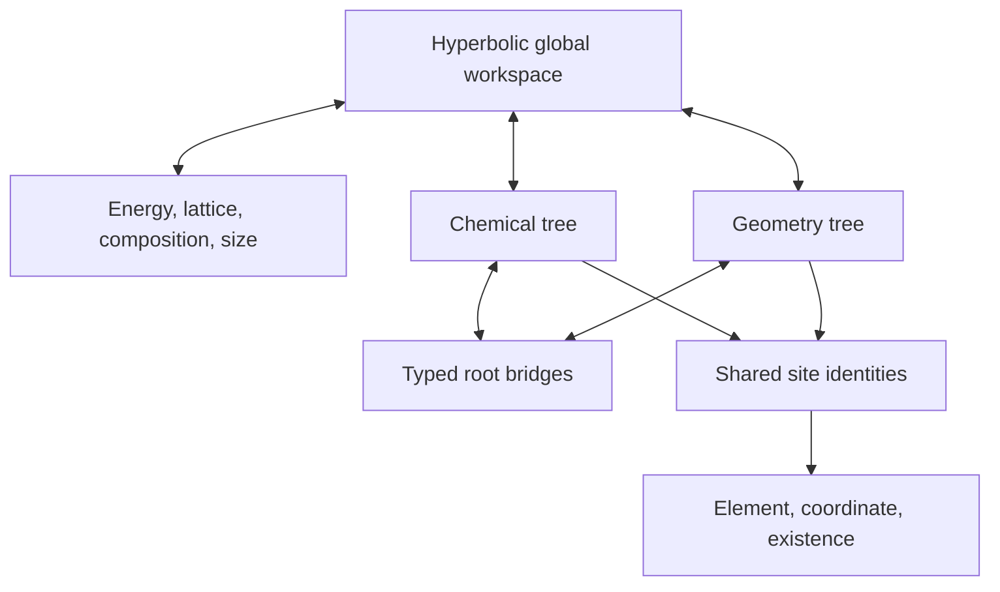

# HMTF Crystal Generator — Initial Implementation

HMTF is an initial implementation of the proposed **Hyperbolic Multi-Tree
Factor** generator for inorganic crystals.  It is a new project rather than a
patch to WyckoffCDVAE.

The model jointly generates

\[
Y=(e_f,L,C,N,\{m_i,Z_i,F_i\}),
\]

where formation energy, lattice, composition, site existence, elements, and
periodic coordinates are all learned factors.  Formation energy is noised and
denoised with the other factors; it is not merely a fixed scalar concatenated
to the input.  The first sampler uses one network and **does not use CFG**.

## What is implemented

- Lorentz-model manifold primitives with safe projection and origin maps.
- A configuration-driven registry for any number of hierarchy plugins.
- Chemical and geometry tree plugins as the initial active trees.
- Learned soft routing from shared sites to multiple hierarchy levels.
- Shared site identities with separate per-tree hyperbolic views.
- Explicit `MultiTreeEncoder`, `CrossTreeLatentCore`, and `MultiTreeDecoder` modules.
- Sample-specific tree roots, root-level cross-tree bridges, and a dynamic
  hyperbolic global workspace.
- Periodic all-pairs physical messages using fractional coordinates and the
  current lattice.
- Joint corruption of energy, lattice, composition, element, coordinate, and
  existence factors with asymmetric coarse-to-fine schedules.
- Joint denoising heads, tree diagnostics, consistency losses, a training-step
  component, and a CFG-free sampling skeleton.
- Typed extension contracts for future defect and recipe trees.

This version is an architectural and numerical prototype with an MP-20/CDVAE
CSV adapter. It does not contain a trained production checkpoint, a DFT/MLIP
energy evaluator, defect thermodynamics, or a synthesis database.

## Architecture

Each active tree exports a root representation and a leaf view.  Tree roots
communicate through bridge attention and the global workspace.  Tree-specific
messages return to the same shared site identities.



The three-module path contains no two-tree assumption. Adding the following
config creates and fuses a third tree without changing the model core:

```yaml
- name: property
  kind: generic
  leaf_entity: site
  groups: [6, 3]
  output_factor: property
```

New plugin kinds can be registered with `@register_tree("kind")`.  Future
defect and recipe plugins may use different leaf entity banks; their interfaces
and required bridges are declared in `hmtf.plugins.extensions`.

## Factor schedules

All factors are fully corrupted at the end of the forward process.  The energy
schedule retains more signal at intermediate time than the lattice and local
site factors, so its estimate becomes useful earlier in reverse generation.
The schedule is configurable and must be validated experimentally.

The independent structure-energy evaluator is deliberately an interface.  It
must read the generated structure, never the generated energy factor.  This
prevents the energy channel from reporting a low number that is inconsistent
with the actual crystal.

## Installation

```bash
python -m venv .venv
source .venv/bin/activate
pip install -e '.[test]'
```

The initial code targets Python 3.10+ and PyTorch 2.2+.

## Verification

```bash
pytest
python scripts/smoke_test.py
```

The smoke script creates synthetic tensors, executes one training step, and
runs a two-step sample.  Synthetic structures are only for shape and gradient
checks; they are not scientifically meaningful training data.

## Minimal training and sampling

### Prepare MP-20

The standard CDVAE MP-20 layout is expected to contain `train.csv`, `val.csv`,
and `test.csv`. Each CSV must contain a CIF column (`cif`, `structure`, or
`cif_string`) and formation energy per atom. Preserve the official splits:

```bash
pip install -e '.[test,mp20]'
python scripts/prepare_mp20.py \
  --input-dir /path/to/mp_20 \
  --output-dir data/mp_20_hmtf \
  --max-sites 20
```

The command writes `train.jsonl`, `val.jsonl`, `test.jsonl`, plus a conversion
report containing invalid and over-capacity row counts. It does not silently
move samples between splits. Arbitrary CIF cells are converted to an equivalent
lower-triangular cell using their Gram matrix, preserving periodic distances.

Train on the converted split:

```bash
python scripts/train.py \
  --data-dir data/mp_20_hmtf \
  --config conf/base.yaml \
  --output runs/hmtf_mp20.pt \
  --epochs 50 \
  --batch-size 32
```

The epoch line contains only the total training loss. At the end of training,
the script prints raw values, weights, and weighted values for every component,
including the differentiable minimum-distance penalty. For each active unique
periodic pair, the threshold is

```text
d_min(i, j) = (0.7 + radius(i) + radius(j)) * 0.5
```

and the penalty is the mean squared positive violation
`relu(d_min - d_actual)^2`. Expected covalent radii are computed from soft
element probabilities, so the term provides gradients to elements, coordinates,
and lattice parameters. The offset, scaling factor, and loss weight are set in
`conf/base.yaml`.

The chemical and geometry hierarchies use deliberately different factor
contexts before their roots communicate. The chemical tree receives energy,
composition, and size tokens; the geometry tree receives energy, lattice, and
size tokens. Both retain the shared periodic physical stem, so specialization
does not remove chemistry-geometry coupling. Noisy existence is used as soft
leaf mass, preventing empty candidate slots from dominating a hierarchy.
Routing regularization combines balanced group use, low per-site entropy, and
multi-level co-assignment decorrelation between trees.

The current CLI uses the training split and stores its energy normalization in
the checkpoint. Validation metrics and early stopping should be added before a
long production run.

### Portable JSONL

After preprocessing a dataset into the JSONL contract below:

```bash
python scripts/train.py \
  --data data/train.jsonl \
  --config conf/base.yaml \
  --output runs/hmtf_initial.pt \
  --epochs 50

python scripts/sample.py \
  --checkpoint runs/hmtf_initial.pt \
  --output runs/generated.jsonl \
  --num-samples 100
```

The sampler reports the jointly generated energy factor and explicitly marks it
as unverified.  A structure-only energy evaluator must be connected before the
number is interpreted as a physical prediction.

## Data contract

`CrystalRecord` expects:

- formation energy in eV/atom from one consistent reference convention;
- one-based atomic numbers;
- fractional coordinates;
- any nonsingular 3x3 row-vector lattice matrix (canonicalized at collation);
- at most `max_sites` atoms.

`collate_records` converts atomic numbers to zero-based model indices, pads to
the computational capacity, derives composition, converts the cell to the
six-parameter positive-volume representation, and normalizes energy.

Real preprocessing must additionally standardize cells, deduplicate structures,
keep related relaxation trajectories in one data split, and retain the
normalization statistics with each checkpoint.

## Suggested next milestones

1. Add validation metrics, early stopping, and distributed/checkpoint-resume training.
2. Connect a validated structure-only energy/force/stress evaluator.
3. Train the core chemical and geometry trees and measure routing collapse.
4. Compare against a parameter-matched Euclidean multi-tree baseline.
5. Add on-policy generated structures and low-noise energy consistency.
6. Implement a defect-candidate entity bank and its site/supercell bridges.
7. Implement a recipe process DAG and its composition/phase bridges.

## Important scientific limitations

- Formation energy alone does not imply low energy above hull.
- Learning the joint energy distribution does not automatically prefer its
  low-energy tail; training weights, same-composition ranking, or controlled
  energy-factor sampling are still needed.
- Per-site energy attribution is not uniquely defined by a DFT total energy.
- Recipe feasibility requires reaction, precursor, phase, and experimental
  process data; it cannot be inferred from formation energy alone.
- This repository does not claim that the architecture is literature-novel or
  superior until a systematic search and controlled experiments are complete.
